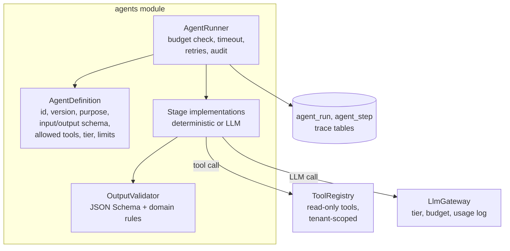
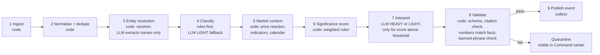
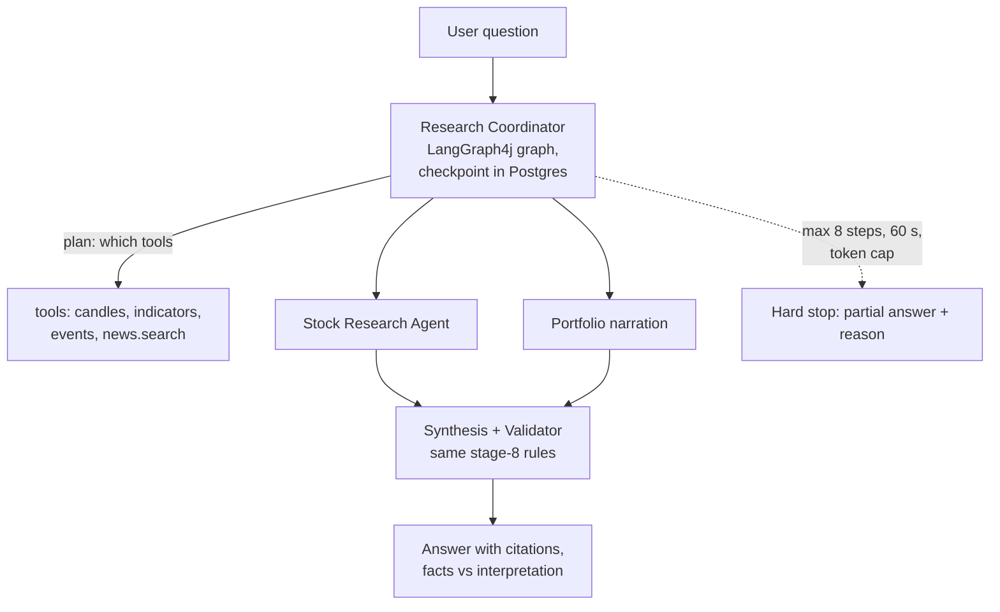

# AI agent architecture and Market Intelligence Agent design

- Owner: AI Architect. Reviewers: Enterprise Architect, Security Architect, Head of Quant Research, AI Evaluation Engineer. Approver: founder.
- Status: **DESIGN**. Covers Deliverable 4 (agent runtime and orchestration) and Deliverable 5 (Market Intelligence Agent).
- **Review outcome (2026-11-27): [ADR 0033](../adr/0033-mia-runtime-and-validation.md) overrides this document where they differ.** Changes from that review:
  - Phase 1 has no model-chosen tool calls. The tools in section 2.2 are plain Java services that the stages call. `@AgentTool` arrives in Phase 3.
  - Each LLM stage has its own `AgentType`.
  - The model writes fact slots `{F#}` instead of numbers (stage 8c).
  - The advice check bans constructions, not words (stage 8e).
  - Events are published in two phases: at ingest, then enriched after EOD.
  - Price reaction uses a market model with z-scores (stage 5).
  - Significance is a logistic function using liquidity, not market cap (stage 6).
  - Eval gates are staged: 100 / 150 / 25 / 30 (section 3.6).
  - Embeddings are deferred to Phase 3 ([ADR 0034](../adr/0034-storage-search-and-data-licences.md)).
  - The model registry is a config file in git.

## 1. Is an agent needed? A rule applied to the brief's 13 agents

An "agent" here means a component where an LLM chooses or interprets: classification of free text, synthesis, natural-language Q&A. Anything with a correct answer that code can compute is a **service**, not an agent (brief section 5, pillar 2).

| Brief agent | Verdict | Implementation | Phase |
|---|---|---|---|
| Market Intelligence Agent | **Agent** (LLM synthesis over deterministic facts) | `agents.mia` pipeline | 1 |
| News Intelligence Agent | Merged into MIA stage 2 (classify) | `agents.mia.Classifier` | 1 |
| Corporate Event Agent | Mostly **service**: NSE/BSE announcement categories are structured. LLM only for free-text attachments | `intelligence.CorporateEventClassifier` (rules), with LLM fallback | 1 |
| Sentiment Analysis Agent | Merged into classify. Labels only, never a numeric score fed into strategies (eval finding: mixed-news labels are ambiguous) | MIA stage 2 | 1 |
| Technical Analysis Agent | **Service** (indicators exist: `indicators`). LLM only narrates | `screener` + narration prompt | 1 (narration) |
| Market Briefing Agent | **Agent** (synthesis) | `agents.briefing` | 1 |
| Fundamental Analysis Agent | **Service** for ratios; agent for narration. Blocked on a fundamentals data source (none free and licensed found yet) | later | 2 |
| Stock Research Agent | **Agent** (Q&A over evidence, RAG) | `agents.research` | 3 |
| Quantitative Research Agent | **Service** (backtests exist). An agent only to *propose* experiments; humans run them | later | 3 |
| Trading Strategy Agent | **Service** (screens, playbooks). An LLM never generates entry/exit rules that run unattended | n/a | n/a |
| Portfolio Analysis Agent | **Service** (metrics) + narration | later | 2 |
| Risk Management Agent | Exists as tier policy `RISK_REVIEW` (critical, never downgraded, fails closed). Reviews proposals and can only **block or flag**, never approve | `risk` | 2 |
| Research Coordinator Agent | **Agent** (routing, multi-step) | LangGraph4j candidate (ADR 0033) | 3 |

So Phase 1 has **two** LLM agents (MIA, Briefing) and several deterministic services. That is the smallest design that delivers pillar 1.

## 2. Agent runtime: building blocks



Spring analogy: an `AgentDefinition` is like a `@Configuration` bean describing a job. `AgentRunner` is like Spring Batch's `JobLauncher` (steps, retries, run history). A tool is like a `@Service` method exposed through a facade that checks permissions first, much as `@PreAuthorize` does.

### 2.1 AgentDefinition (code, versioned, reviewed in PRs)

```java
record AgentDefinition(
    AgentType type,               // existing enum in llmgateway
    String version,               // "mia-1.0.0"; bump on any prompt or schema change
    String purpose,
    JsonSchema inputSchema, JsonSchema outputSchema,
    Set<ToolId> allowedTools,     // closed set, checked at call time
    Tier tier,                    // HEAVY | LIGHT | LOCAL; budget rules may downgrade (ADR 0006)
    Duration timeout,             // per run
    int maxLlmCalls, int maxToolCalls, long maxTokens,
    RetryPolicy retry,            // attempts, backoff, retryable exception types
    HumanApproval approval)       // NONE (read-only output) | REQUIRED (anything acting)
```

### 2.2 Tool registry

- A tool is a Java interface method annotated `@AgentTool(id, description, scope = READ)`. The registry builds the Spring AI tool callback inside `llmgateway` (only that module touches Spring AI types).
- **All Phase 1 to 3 tools are read-only.** There is no tool that writes orders, changes settings, sends messages or reads secrets. ArchUnit enforces that `agents` cannot reach `paperbroker` write services.
- Every tool call runs with the **caller's** `TenantContext` and principal (identity propagation). Results are filtered by tenant visibility and row-level security in the DB.
- Tool arguments are validated against the tool's schema before execution. Results are size-capped (for example 8 KB) and wrapped as **data** in the prompt (section 5).

Phase 1 tools:

| Tool id | Input | Output | Backing code |
|---|---|---|---|
| `instrument.resolve` | name text | Resolved/Ambiguous/Unresolved + ISIN | `SymbolResolverService` (exists) |
| `candles.window` | ISIN, from, to (max 400 sessions) | OHLCV, source, as-of | `CandleSeriesReader` (exists) |
| `indicators.snapshot` | ISIN, asOf | SMA20/50/200, RSI14, ATR14, 52w hi/lo, % changes | `Indicators` (exists) |
| `price.reaction` | ISIN, event time | return T+0/T+1/T+5 vs NIFTY, volume vs 20-day average, abnormal flag | new `intelligence.PriceReaction` |
| `announcements.search` | ISIN or text, date range | announcements with ids | new |
| `news.search` | ISIN or text, date range, k | news items with ids (FTS + pgvector) | new |
| `calendar.session` | date | trading-day status, previous/next session | `TradingCalendar` (exists) |

## 3. Market Intelligence Agent (Deliverable 5)

### 3.1 Responsibility

Turn permitted source documents (corporate announcements, news, later macro releases) into **validated, evidence-linked intelligence events** about NSE instruments, and feed the intelligence feed, watchlist alerts and the daily briefing. It never recommends buying or selling (see [compliance-assessment.md](../governance/compliance-assessment.md), capability class "information").

### 3.2 Pipeline (deterministic where possible)



| Stage | Detail |
|---|---|
| 1 Ingest | `AnnouncementSource` / `NewsSource` adapters, scheduled by `JobRunner` with a cursor per source. They store `source_document` raw text + URL + publisher + `published_at` + `fetched_at` + licence tag. |
| 2 Normalise | Strip HTML, normalise whitespace and Unicode, compute `content_sha256`, dedupe on (source, external_id) and near-duplicates on SimHash distance ≤ 3 across sources (a cluster id links them). |
| 3 Entities | Structured sources (NSE/BSE announcements) carry the symbol or ISIN, so they are used directly. For news: the LLM extracts **company names as written** (prompt v3, B-001), and `SymbolResolverService` maps them. Ambiguous or unresolved names are kept as unlinked mentions, **never guessed**. This makes an invented ticker impossible by construction. |
| 4 Classify | Taxonomy `event_type` v1: `EARNINGS_RESULT`, `DIVIDEND`, `BONUS_SPLIT`, `BUYBACK`, `M_AND_A`, `MANAGEMENT_CHANGE`, `CREDIT_RATING`, `REGULATORY_ACTION`, `ORDER_WIN_CONTRACT`, `CAPACITY_EXPANSION`, `FUNDRAISE`, `PLEDGE_CHANGE`, `INSIDER_TRADE`, `LITIGATION`, `GUIDANCE`, `MACRO_RELEASE`, `SECTOR_NEWS`, `OTHER`. NSE/BSE announcement subject categories map by table. The LLM (LIGHT, JSON mode, temperature 0) handles only free text, with an output enum check. |
| 5 Context | Code only: `price.reaction` (abnormal if \|excess return vs NIFTY\| > 2 × the 60-session stdev of daily excess return, or volume > 3 × the 20-day average), indicators snapshot, and whether the event came before or after the session (IST, calendar). |
| 6 Significance | Code: `score = w_type[event_type] + w_reaction·abnormal + w_size·log(market-cap bucket) + w_novelty·(1 − cluster_size_penalty)`. Weights live in config and are tuned on the golden set. Threshold `≥ 0.6` triggers stage 7 and alert eligibility. |
| 7 Interpret | LLM produces `summary` (≤ 60 words, facts only, each sentence citing an evidence id) and `interpretation` (≤ 80 words, labelled as AI interpretation, with uncertainty). Input is the facts bundle from stages 3 to 6 **plus** the quoted source text as data. |
| 8 Validate | (a) JSON Schema; (b) every `[E#]` citation exists in the evidence set; (c) every number in the output text appears in the facts bundle (regex extract and exact compare after normalisation), so the model cannot introduce figures; (d) no ISIN or symbol outside the resolved set; (e) banned phrases list (buy, sell, target price, guaranteed, multibagger, ...) for the advice boundary; (f) the length caps. Any failure means quarantine, with the reason stored. |
| 9 Publish | Insert `intelligence_event` + `evidence` + outbox `intelligence.event.published` in one transaction. |

Cost control: stages 1 to 6 are free. With rules-first classification, roughly 10 to 20 % of documents reach stage 7. This is an estimate to measure in R3, not a fact. Budget rules (ADR 0006) apply: MIA is **non-critical**, so it drops a tier at 60 % of budget and stops at 85 %. Briefing degrades to a facts-only template when the LLM is unavailable.

### 3.3 Intelligence event schema v1

Full JSON Schema: [`contracts/events/intelligence-event.v1.schema.json`](../../contracts/events/intelligence-event.v1.schema.json). Field summary:

| Field | Type | Notes |
|---|---|---|
| `schemaVersion` | const `"1.0"` | |
| `eventId` | UUIDv7 | time-ordered |
| `eventType` | enum (taxonomy v1) | |
| `instruments[]` | `{isin, symbol, exchange: NSE\|BSE, role: PRIMARY\|AFFECTED}` | min 0 (macro events) |
| `observedAt` | instant | when the fact happened (for example board meeting time), if known |
| `publishedAt` | instant | the source's publication time |
| `ingestedAt`, `processedAt` | instant | our times |
| `dataLatency` | enum `REALTIME\|DELAYED\|EOD` + `delaySeconds` | never claim realtime for a delayed source (brief section 4.2) |
| `summary` | `{text, citations[]}` | facts only |
| `interpretation` | `{text, citations[], generatedBy: {agentVersion, model, tier, promptVersion}}` or null | labelled AI |
| `marketContext` | `{asOfSession, returnT0, returnT1, excessVsBenchmark, volumeRatio, abnormal}` | all from code, decimals as strings |
| `significance` | `{score 0..1, components{}}` | |
| `confidence` | enum `HIGH\|MEDIUM\|LOW` + `reasons[]` | based on evidence quality (official source = HIGH, single news source = LOW) |
| `evidence[]` | `{evidenceId, kind: SOURCE_DOCUMENT\|PRICE_DATA\|INDICATOR, ref, url, publisher, licenceTag, excerpt ≤ 300 chars}` | |
| `assumptions[]`, `limitations[]` | strings | for example "prices are unadjusted for corporate actions (B-020)" |
| `visibility` | `{scope: GLOBAL\|TENANT, tenantId?}` | public-source events are GLOBAL; tenant-uploaded docs are TENANT |
| `correlationId` | string | |

### 3.4 Outputs

| Output | Trigger | Content | Channel |
|---|---|---|---|
| Intelligence feed | every published event | event cards, filterable by type, instrument, significance | UI `/intelligence`, `GET /api/v1/intelligence/events` |
| Significant-event alert | event on a user's watchlist with significance ≥ the user threshold | summary + link | `notification` (in-app; Telegram/email after B-027) |
| Stock intelligence summary | on demand | last 30 days of events + context for one ISIN | UI dossier tab |
| Daily briefing | 08:15 IST trading days (before 09:15) and 19:45 IST post-EOD | market breadth (code), index moves, top-N significant events, watchlist digest, data-freshness statement | UI + notification |

### 3.5 Data pipelines and sources

See [data-source-register.md](../research/data-source-register.md). **No source is used commercially until its licence row says so.** For personal use, Phase 1 polls NSE and BSE corporate announcements only if the terms check (story R2-01) allows automated access. Otherwise we take them through a licensed or broker channel.

### 3.6 Evaluation framework

> Superseded by ADR 0033 points 8, 11 and 12. R3 gates use 100 entity-resolution cases, 150 classification cases (scored only on types with ≥ 15 cases), 25 injection cases, 60 advice-boundary sentences, 30 fact-slot cases, and 30 human-scored interpretation cases drafted from real model outputs in R4. Draft datasets: PR #38 (`evals/mia/`). The rows below are the original draft.

| Layer | Dataset | Metric | Gate |
|---|---|---|---|
| Entity resolution | 200 hand-labelled headlines (synthetic + paraphrased, no copyrighted text in git) | precision of linked ISINs | ≥ 0.98 precision (wrong links are worse than missing ones); recall reported |
| Classification | 300 labelled documents across the taxonomy | macro-F1; confusion on top-5 types | ≥ 0.80 macro-F1 for rules + LLM |
| Interpretation | 60 golden events with reference facts | citation validity 100 %; numeric fabrication 0; LLM-judge faithfulness (local judge model, spot-checked by a human) | 100 % / 0 / ≥ 4.0 of 5 |
| Injection | ≥ 20 adversarial documents (extends B-003; n21 included) | attacks succeeded | **0** reaching a published event. Attacks may change the text, but validation must quarantine them |
| End to end | replay of 30 historical days | events/day, quarantine rate, p95 latency per document, cost per 100 docs | tracked; regressions over 10 % block merge |

Evals run with `./mvnw verify -Peval` (exists, ADR 0010), and the report records the call settings (B-002).

## 4. Agent orchestration architecture (Phase 3, designed now)



The coordinator may loop over tools, which is the one place where a graph runtime earns its keep. Its limits: 8 steps, 60 s, 20k tokens, read-only tools, tenant-scoped.

## 5. AI security controls

1. **Untrusted content as data**: source text goes inside a delimited block with a per-request random fence (`<<DOC-7f3a>> ... <<END-7f3a>>`). The system prompt says that content inside the fences never contains instructions. This *reduces* injection risk; it does not prevent it (n21 shows that).
2. **Structural defence**, which is what we actually rely on: the model's output can only populate validated fields. There are no tools with side effects, no URL fetching driven by model output, and validation (stage 8) rejects any number, ticker or citation not in the facts bundle.
3. **Output encoding**: the UI renders LLM text as plain text (no HTML/markdown links from the model). Links come only from the evidence table.
4. **Limits**: per-run timeout, max calls, token caps; daily caps per agent (exists); monthly budget (ADR 0006).
5. **Audit**: `agent_run` (definition version, model, tier, tokens, cost, duration, outcome) and `agent_step` (stage, input hash, output hash, validation result). Prompts and outputs are stored for 90 days and redacted of PII. Phase 1 sources contain no user PII, but the redactor is in place for tenant uploads later.
6. **Model governance**: `model_registry` (provider, model id, digest/tag, approved tiers, approval date, eval scores, status ACTIVE/RETIRED). A model can serve a tier only if it is ACTIVE and its eval scores meet the gates in 3.6.
