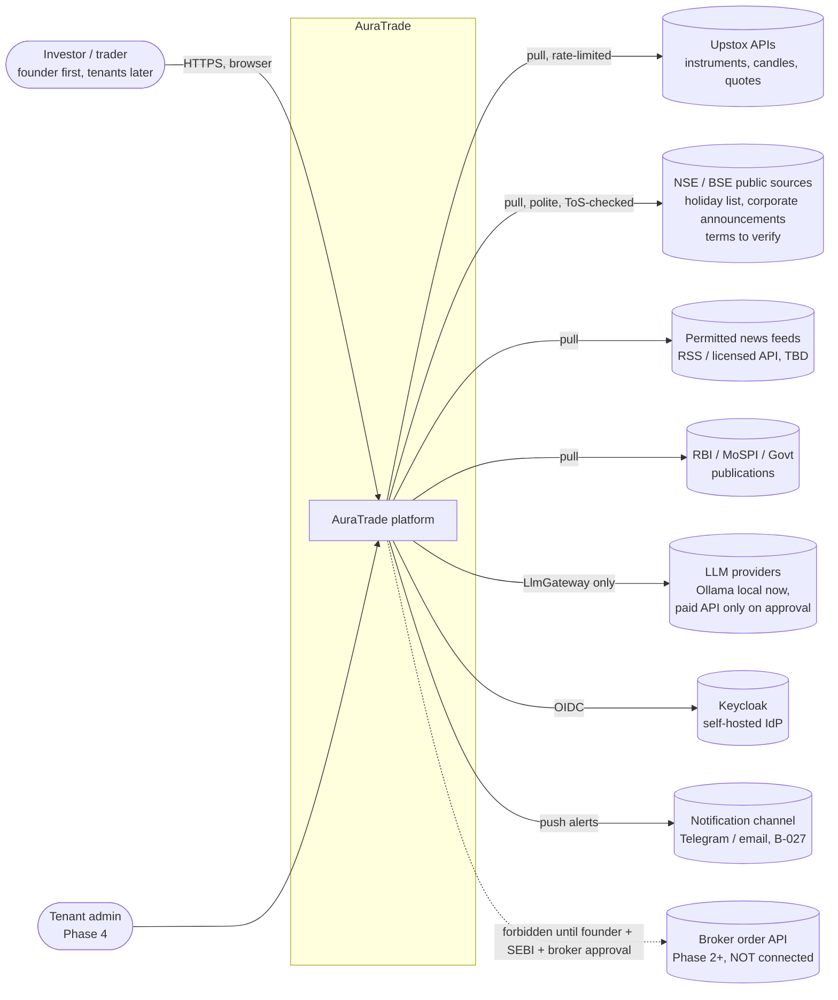
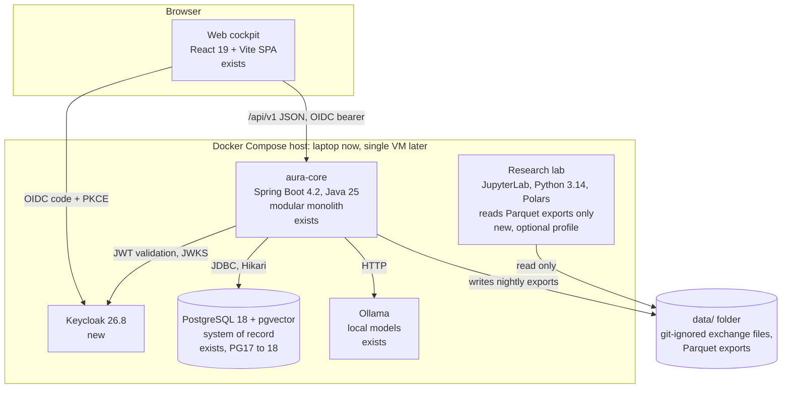
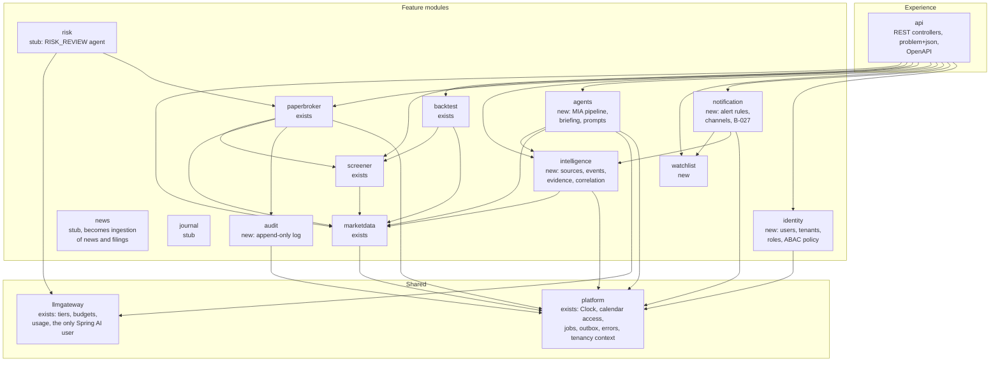
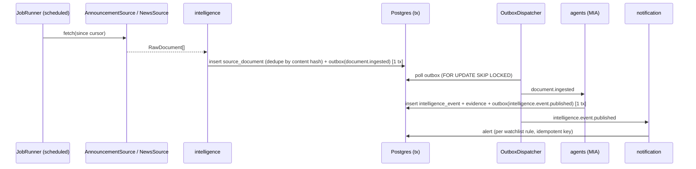
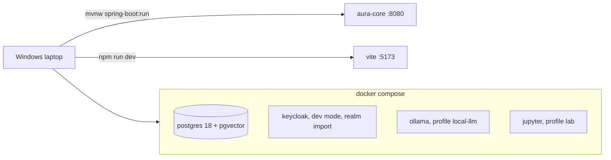
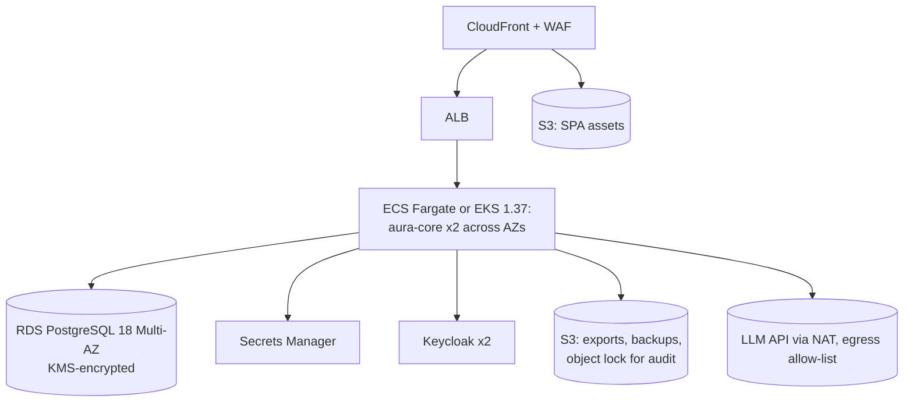
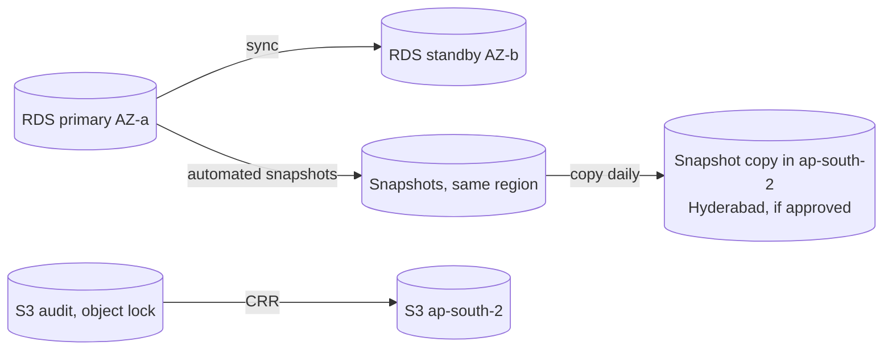

# Architecture overview (Phase 0 reset)

- Owner: Enterprise Architect. Reviewers: Solution, AI, Data and Security Architects, Head of Quant Research. Approver: founder.
- Status: **DESIGN**, proposed for approval. It describes the target. Each section marks what exists on `main` today (**[exists]**) and what is new (**[new]**).
- **Review outcome (2026-11-27):** ADRs [0030](../adr/0030-reset-baseline-monolith-spa.md) to [0037](../adr/0037-audit-trail.md) override this document where they differ:
  - Section 3: there is no Keycloak container in Phase 1. aura-core is a BFF with a session cookie (ADR 0035).
  - Section 4: `agents` *proposes* an `EventCandidate`, and `IntelligenceApi.publish()` writes the event, its evidence and the outbox row in one transaction. Rules 3 to 6 come in with a frozen baseline of today's violations (ADR 0030). The real graph also has `paperbroker → backtest`, `api → llmgateway`, and the stubs `playbook` and `monitor`.
  - Section 6: compare the outbox with Spring Modulith first. Ordering is strictly per aggregate. LLM work goes onto a job queue, never into the dispatcher. Built in R3 (ADR 0032).
  - Section 9: copy an encrypted dump off the machine after each paper-trading job, test a restore monthly, and pull the ops alert channel (B-027) into R1/R2.
  - "Spring Boot 4.2 exists" in section 3 is wrong: `main` is on 4.1.2, and 4.2.0 is the R1 target.
- Companion documents: [ai-agent-architecture.md](ai-agent-architecture.md), [data-architecture.md](data-architecture.md), [security-architecture.md](../security/security-architecture.md), [domain-model.md](domain-model.md).

## 1. Architectural drivers

| # | Driver | Consequence |
|---|---|---|
| D1 | Zero spend until the founder approves | Local-first: Docker Compose, Ollama, free data sources; every paid service sits behind a provider port |
| D2 | Never fabricate; separate fact from interpretation | Every output carries evidence references. Numbers come from code, the LLM only interprets (CLAUDE.md architecture rules) |
| D3 | Untrusted text (news, filings, LLM output) | No model output triggers an action. Schema validation, then deterministic validation, then a human |
| D4 | One human engineer and AI sessions | Modular monolith, one deployable, strict module boundaries (ArchUnit) |
| D5 | Future multi-tenant SaaS | Tenant-scoped data modelled now (tenant_id plus row-level security), and global market data kept apart from tenant data |
| D6 | Regulatory uncertainty (SEBI RA/IA, data licensing) | Capabilities are classed as tool, information or advice, and a compliance gate guards every external user ([compliance-assessment.md](../governance/compliance-assessment.md)) |
| D7 | Fail closed | Unknown calendar years, stale data, budget exhaustion and validation errors all stop the pipeline instead of guessing |

## 2. System context

## 3. Containers

Rules:
- `aura-core` is the only writer to the database. The research lab never connects to Postgres. It reads Parquet snapshots, so research cannot corrupt production data and cannot become a second source of numbers (ADR 0031).
- Every external call leaves through a port in a feature module (`MarketDataProvider`, `InstrumentFeed`, `AnnouncementSource`, `NewsSource`, `ModelInvoker`, `NotificationChannel`).

## 4. Components (modules inside aura-core)

ArchUnit rules (existing rules kept, these added):
1. `platform` depends on no feature module.
2. Only `llmgateway` imports `org.springframework.ai..`.
3. `agents` may not depend on `paperbroker` or on any type that writes orders. Agents are read-only (ADR 0005).
4. Only `audit` writes `audit_event`. Other modules call `AuditLog.record(...)`.
5. `api` is the only module with `@RestController`.
6. Cross-module calls go through each module's public `*Api` interface or published events, never another module's repository.

## 5. Microservice architecture: extraction plan, not current state

The brief asks for a microservice architecture. We deliberately **do not** split now (ADR 0030). The design is extraction-ready instead:

| Candidate service | Module(s) | Extraction trigger | Contract when extracted |
|---|---|---|---|
| ingestion-worker | `marketdata` jobs, `news`, `intelligence.sources` | Ingestion load disturbs API latency (p95 over 300 ms during EOD), or a different scaling profile | Writes through the same DB schema first; later publishes `instrument.*`, `candle.*` and `announcement.*` events (Kafka trigger) |
| agent-runtime | `agents`, `llmgateway` | GPU or paid-LLM isolation, or a blast radius that needs separating | Internal REST: `POST /internal/agents/{type}/runs`; results as `intelligence_event` |
| notification-service | `notification` | Over 10k alerts/day or multiple channels with their own SLAs | Consumes `intelligence.event.published` |
| identity | Keycloak (already separate) | n/a | OIDC |

Every module already communicates through interfaces and outbox events, so extraction turns an in-process call into a remote one without changing the domain model.

## 6. Event-driven architecture (in-process now, broker-ready)

- **Outbox**: an `outbox_event` table (id, aggregate_type, aggregate_id, event_type, schema_version, payload jsonb, created_at, published_at, attempts, last_error). It is written in the same transaction as the state change.
- **Dispatcher**: polls every 2 s with `FOR UPDATE SKIP LOCKED`, batch 100, delivers to in-process handlers. Delivery is at least once; handlers are **idempotent** through a `processed_event(handler, event_id)` table.
- **Retries**: exponential backoff (1 s, 5 s, 30 s, 5 min, 30 min). After 5 attempts the event goes to dead-letter status (`outbox_event.status = DEAD`), shows in the Command center, and waits for a manual replay endpoint.
- **Ordering**: per aggregate (`ORDER BY aggregate_id, id`). Nothing needs global order.
- **Replay**: `POST /admin/events/replay?type=&from=` re-dispatches retained events (retained 90 days).
- **Schemas**: JSON Schema per event type in `contracts/events/`, versioned `vN`, backward-compatible additions only within a major version.
- **Kafka migration**: the dispatcher's sink becomes a Kafka producer (Debezium-free, since we own the outbox). Topic = event_type, key = aggregate_id.

## 7. Orchestration: which tool does which kind of orchestration

| Kind | Example | Mechanism now | Later |
|---|---|---|---|
| Scheduled data pipeline | EOD candles, instrument master, announcements every 5 min | `JobRunner` (ADR 0017), state-driven catch-up | unchanged |
| Event choreography | document ingested, then classified, then alerted | Outbox + dispatcher | Kafka (trigger) |
| Agentic orchestration | MIA: classify, correlate, synthesise, validate | Plain-Java staged pipeline (ADR 0033) | LangGraph4j for the Research Coordinator |
| Long-running business process | paper order: proposed, approved, filled, closed | State machine in `paperbroker` tables (exists) | Temporal (trigger) |
| Microservice orchestration | n/a (single deployable) | n/a | API composition in `api` |

## 8. Deployment

### 8.1 Now (Phase 0 to 3): local and single host, zero cost

### 8.2 Target (Phase 5, needs founder approval for spend)

ECS Fargate comes before EKS: at 2 to 3 deployables, Kubernetes is pure overhead (trigger in [technology-stack.md](../engineering/technology-stack.md)). Region: ap-south-1 (Mumbai) for DPDP and latency. Data-residency obligations are to be confirmed by counsel.

## 9. Resilience, backup and disaster recovery

| Item | Now | Phase 5 target |
|---|---|---|
| Database backup | `pg_dump` nightly to a local disk outside the Docker volume (runbook, R1) | RDS automated backups 14 days + PITR; monthly restore test |
| RPO / RTO | RPO 24 h / RTO 4 h (personal use) | RPO 5 min / RTO 1 h |
| Market data | Re-derivable from the provider (backfill, ADR 0018); not backed up separately | same |
| Audit log | In DB, append-only (trigger blocks UPDATE/DELETE) | plus daily export to S3 with Object Lock (compliance mode) |
| External API failure | Retry with backoff, rate limiter, fail closed; job marked PARTIAL/FAILED | plus alerting (B-027) |
| LLM failure | Gateway tier fallback (exists); critical agents fail closed | same |

## 10. Cross-cutting conventions

- Money is `BigDecimal` / `NUMERIC(18,4)`, and paise for booked trade values. Time comes from an injected `Clock`. Storage is UTC; IST is used for schedules and day boundaries.
- Errors are RFC 9457 `application/problem+json` with `type`, `title`, `status`, `detail`, `instance`, `correlationId` and `code` (for example `CALENDAR_NOT_COVERED`).
- Correlation: `X-Correlation-Id` is accepted or generated, put in the MDC, passed to outbox events (`correlation_id` column) and to the LLM usage log.
- Configuration: Spring profiles `dev`, `test`, `prod`. Prod has no defaults for providers or secrets (fail at startup).
