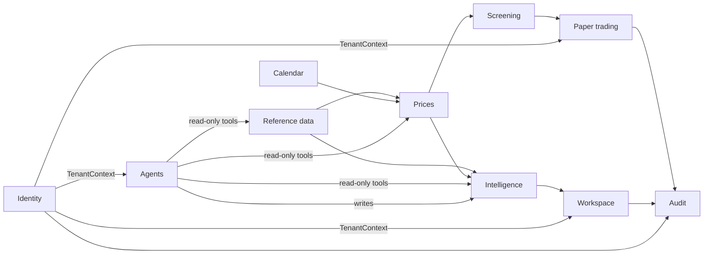

# Domain model

- Owner: Enterprise Architect. Status: **DESIGN**.

## Bounded contexts (modules) and their language

| Context | Aggregates | Key invariants |
|---|---|---|
| Reference data (`marketdata`) | Instrument (identity: ISIN; indices by segment + symbol), ProviderKey, Alias | symbols are not unique; ISIN check digit valid |
| Prices (`marketdata`) | CandleSeries (instrument, source, interval) | validator ERROR rules hold; DAY bars at IST midnight; sessions only on calendar trading days |
| Calendar (`marketdata`) | TradingCalendar (per year) | an uncovered year throws |
| Intelligence (`intelligence`) | SourceDocument, DocumentCluster, IntelligenceEvent (with Evidence) | an event has ≥ 1 evidence item; every citation resolves; status PUBLISHED, QUARANTINED or RETRACTED; a retraction keeps history |
| Agents (`agents`, `llmgateway`) | AgentDefinition, AgentRun, ModelRegistryEntry, UsageEntry | runs within limits; critical agents fail closed |
| Screening and research (`screener`, `backtest`) | Screen, Shortlist, BacktestRun | no look-ahead (signals as of close, entry next open) |
| Paper trading (`paperbroker`) | PaperAccount (go-live criteria), PaperOrder (PROPOSED → APPROVED/REJECTED/EXPIRED → FILLED), Position, Trade, EquityPoint | decisions only before 09:15 IST of the fill date; a human decides every order |
| Workspace (`watchlist`, `notification`) | Watchlist, AlertRule, Alert | alert idempotent per (rule, event) |
| Identity (`identity`) | Tenant, AppUser, RoleBinding, Entitlement | user belongs to exactly one tenant (v1) |
| Audit (`audit`) | AuditEvent | append-only, hash-chained |

## Context map

Upstream contexts publish; downstream contexts consume through module `*Api` interfaces or outbox events. Agents are a downstream consumer of reference, price and intelligence data and the only *writer* of AI-generated intelligence fields. They never write to Paper trading.
