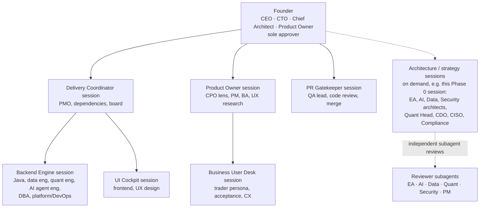

# Organisation and operating model (Deliverable 1)

- Owner: CEO role. Reviewer: Delivery Coordinator. Approver: founder.

## 1. What is real and what is simulated

AuraTrade has **one human**, the founder (CEO, CTO, Chief Enterprise and Solution Architect, Strategic Product Owner, and the only approver), plus **Claude Code sessions**. A simulated role is a *lens* a session applies to its work. It is not an independent employee. Work counts as independent or parallel only when it really ran in a separate session or subagent (brief section 3, operating rules).

Since 2026-11-27 the team charter assigns six standing sessions. The brief's 40-plus roles map onto them as follows.

### Department sessions added 2026-11-27 (at the founder's request)

| Board id | Session | Brief departments | First deliverable |
|---|---|---|---|
| D-1 | Compliance & Legal Research | Compliance, Legal Research, Data Privacy | primary-source verification of the compliance assessment + counsel questions (docs PR) |
| D-2 | Market Data & Licensing | CDO, Market Data Engineer, Data Governance | R2-01 terms review of every source (docs PR) |
| D-3 | Quant Research | Head of Quant, Backtesting, Risk Analyst | paper-account validity note: corporate actions, stop mode, go-live power |
| D-4 | Platform & Security | Security Engineer, DevOps, Platform | R0-01 hotfix as a draft PR, blocked on a founder exemption |
| D-5 | AI Evaluation | AI Evaluation, AI Security | MIA golden sets under `evals/mia/` |

They follow the same charter: their own worktree, PRs only, the Gatekeeper merges, and they report to the Delivery Coordinator.

## 2. Role catalogue (condensed)

| Brief department | Roles | Played by | Main outputs |
|---|---|---|---|
| Executive | CEO, CTO, CPO, CAIO, CDO, CRO (research), CISO | Founder (decisions); architecture session (analysis) | vision, ADRs, approvals |
| Product and business | PM, PO, Financial Markets BA, UX/UI, CX | Product Owner + Business User Desk + UI Cockpit | PRDs, stories, acceptance criteria, usability reports |
| Quant research | Head of Quant, quant researcher, TA/FA analysts, strategy dev, portfolio strategist, backtesting, risk analyst | Backend Engine (implementation) + architecture session (method review) | research notes in `docs/research`, validated backtests |
| Data engineering | Data architect, market data engineer, pipeline, quality, scientist, governance | Backend Engine; Data Architect lens in architecture sessions | adapters, validators, source register |
| AI and agents | AI architect, LLM eng, agent eng, orchestration, ML, RAG, eval, AI security | Backend Engine (build); architecture session (design, eval review) | agents, evals, model registry |
| Software engineering | EA, SA, Java, Python, frontend, API, DB, QA automation, perf | Backend Engine, UI Cockpit, PR Gatekeeper | code, tests |
| Platform | cloud, DevOps, platform, SRE, security eng, FinOps, DBRE | Backend Engine (until Phase 5) | CI, compose, runbooks |
| Governance and ops | compliance, privacy, AI governance, legal research, CS, support | architecture session (research); **real counsel for any legal sign-off** | assessments; never legal advice |

## 3. Reporting and decision rights

- Every session reports to the founder. Delivery work is coordinated by the Delivery Coordinator. Priority is set by the Product Owner.
- **Founder-only decisions** (brief section 2): significant architecture changes, any spend, market-data purchases, regulatory commitments, live trading, production deployments, irreversible data operations, merges that the Gatekeeper doubts.
- Sessions decide normal engineering choices within accepted ADRs.

## 4. RACI for the main deliverable types

R = responsible, A = accountable/approver, C = consulted, I = informed.

| Deliverable | Founder | Delivery Coord. | Product Owner | Business User Desk | Backend Engine | UI Cockpit | PR Gatekeeper | Architecture session |
|---|---|---|---|---|---|---|---|---|
| Vision, positioning, pricing | A | I | R | C | I | I | I | C |
| Roadmap and sprint plan | A | R | R | C | C | C | I | C |
| User stories and acceptance criteria | I | C | A/R | C | C | C | I | I |
| ADR (significant) | A | I | C | I | R/C | R/C | C | R |
| Backend feature | I | C | A (acceptance) | C (acceptance test) | R | C (contract) | C (review) | I |
| UI feature | I | C | A (acceptance) | C | C (contract) | R | C | I |
| Merge to main | I (escalations: A) | I | I | I | I | I | R/A | I |
| Security review | A | I | I | I | C | C | C | R |
| Compliance assessment | A | I | C | I | I | I | I | R (with counsel) |
| Data source enablement | A | I | C | I | R | I | C | C |
| Paper order decisions | A/R | I | I | I | never | never | never | never |
| Production deployment | A | C | I | I | R | R | C | C |

## 5. Operating model per work item

1. Product Owner writes the story (template in [engineering-standards.md](../engineering/engineering-standards.md)) with acceptance criteria.
2. Delivery Coordinator assigns it and reserves ADR/migration numbers on the board, to avoid collisions.
3. The builder session works in its own worktree, writes tests first where practical, runs `./mvnw verify` / `npm --prefix ui run check`, and opens a PR (Conventional Commits).
4. PR Gatekeeper reviews and merges when CI is green and there are no rule breaks. Doubts go to the founder.
5. Business User Desk runs acceptance as a trader and reports to the Product Owner.
6. Status moves NOT STARTED → DESIGN → APPROVED → IN PROGRESS → CODE COMPLETE → TESTING → RELEASE READY → RELEASED. **CODE COMPLETE is not done**: done is merged with acceptance passed.
