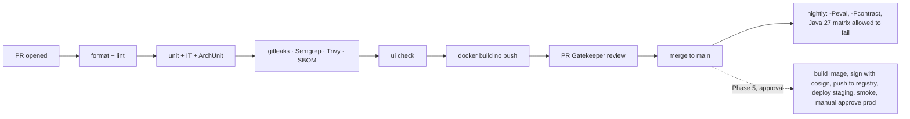

# Engineering foundation (Deliverable 6)

- Owner: CTO / Enterprise Architect. Reviewers: PR Gatekeeper, Security Architect, QA. Approver: founder.

## 1. Repository structure

The brief's tree (`backend/services`, `ai-platform/`, `quant-engine/`, ...) assumes many deployables and languages. We keep **one Maven project at the root** (ADR 0001 and ADR 0030). Moving `src/` would rewrite git history paths and break every running session's worktree for no runtime gain. Instead the brief's areas map onto packages and folders:

```text
auratrade/
├── src/main/java/com/auratrade/
│   ├── platform/        shared kernel (Clock, jobs, outbox, errors, tenancy context)
│   ├── marketdata/      ingestion, calendar, candles            (brief: data-platform/ingestion, quality)
│   ├── screener/        indicators, screens                     (brief: quant-engine/indicators, strategies)
│   ├── backtest/        replay, portfolio sim, sweep            (brief: quant-engine/backtesting)
│   ├── risk/            risk review                             (brief: quant-engine/risk)
│   ├── paperbroker/     paper trading
│   ├── intelligence/    sources, events, evidence     [new]     (brief: data-platform/processing)
│   ├── agents/          MIA, briefing, tool registry  [new]     (brief: ai-platform/agents, tools, orchestration)
│   ├── llmgateway/      the only Spring AI user                 (brief: ai-platform model access)
│   ├── watchlist/ notification/ identity/ audit/     [new]
│   └── api/             REST controllers
├── src/main/resources/db/migration/   Flyway, forward-only
├── src/test/...         *Test (unit), *IT (Testcontainers)
├── evals/               golden sets + eval README           (brief: ai-platform/evaluation)
├── contracts/           JSON Schemas (events), OpenAPI (api/v1)  [new]
├── ui/                  React SPA                            (brief: frontend/)
├── research/            [new] Python lab: pyproject, notebooks (no prod code)
├── infrastructure/      [new] docker/, keycloak/, monitoring/ (later tofu/)
├── scripts/             calendar and ops scripts (exists)
├── docs/{adr,architecture,business,product,engineering,security,governance,research,runbooks,ui}
├── .github/workflows/
├── CLAUDE.md  README.md  CONTRIBUTING.md [new]  LICENSE [new: founder to choose; proprietary recommended]
```

## 2. Development standards

- Java 25, Spring Boot 4.2, constructor injection, records for value types, `sealed` result types (see `SymbolResolverService`: Resolved, Ambiguous, Unresolved).
- Hexagonal *inside* a module where there is an external dependency: port interface in the module, adapter class named after the provider (`UpstoxCandleProvider`). No hexagonal ceremony for pure logic.
- Money is BigDecimal; time comes from an injected Clock; UTC is stored; IST is for boundaries. No `double` in money or price paths (ArchUnit rule: no `double` fields in `backtest`, `paperbroker`, `screener.indicators` value types). Indicator internals may use `double` only where an ADR permits, which none does today.
- Logging: SLF4J, structured key=value, correlation id in the MDC, and never tokens, prompts with PII, or full news bodies.
- Errors: one `@RestControllerAdvice` producing RFC 9457 problems; domain exceptions carry a `code`.
- Config: `@ConfigurationProperties` records with validation, and no defaults in prod for providers or secrets.
- Formatting: Spotless (google-java-format), Prettier, ESLint `--max-warnings 0`.

## 3. API standards

| Topic | Rule |
|---|---|
| Base path | `/api/v1/...` public, `/admin/...` platform admin, `/dev/...` dev profile only |
| Contract | OpenAPI 3.1 document generated (springdoc, verify Boot 4.2 support) **and** checked in at `contracts/openapi/api-v1.yaml`; CI diff fails on an unreviewed breaking change |
| Resources | plural nouns, kebab-case paths, camelCase JSON, ISO-8601 instants (UTC, `Z`), decimals as JSON strings |
| Errors | `application/problem+json`, stable `code` values documented in the contract |
| Pagination | cursor-based: `?limit=50&cursor=…`, response `{items, nextCursor}`; limit max 200 |
| Filtering/sorting | `?filter[eventType]=DIVIDEND&sort=-publishedAt` |
| Idempotency | `Idempotency-Key` header required on POSTs that create or decide (orders, decisions); stored 24 h with the response hash |
| Correlation | `X-Correlation-Id` in and out |
| Versioning | URI major version; additive changes only within v1; deprecation via the `Deprecation` and `Sunset` headers |
| Auth | Bearer JWT (Keycloak); 401 vs 403 distinguished; tenant from the token, **never from the request body or path** |
| Rate limits | per user and per tenant (Bucket4j in memory now; Valkey later), `429` + `Retry-After` |
| Provenance | every data response includes `asOf`, `source`, `dataLatency` |

## 4. Testing standards

| Level | Tool | Scope | Rule |
|---|---|---|---|
| Unit `*Test` | JUnit 5, AssertJ, jqwik (property tests for indicators and cost math) | pure logic | required for every calculation; fixtures synthetic |
| Integration `*IT` | Testcontainers (pgvector image matching prod major) | repositories, RLS, migrations, jobs | required for every migration and query |
| Contract | WireMock stubs from recorded synthetic responses; `-Pcontract` live (exists) | providers | provider adapters need both |
| API | MockMvc / RestTestClient + JSON Schema assertions against `contracts/` | controllers | every endpoint |
| Architecture | ArchUnit | module rules | always |
| Tenant isolation | dedicated `TenantIsolationIT`: two tenants, every tenant-scoped repository, asserting zero cross-reads and writes rejected | Phase 1 scaffold, Phase 4 exit gate | |
| UI | Vitest + Testing Library + MSW (exists); Playwright e2e on the main flows (new) | | |
| AI | `-Peval` golden sets; injection set; citation and numeric-fabrication checks | nightly | gates in ai-agent-architecture section 3.6 |
| Performance | k6 against the dev profile for `/api/v1` (Phase 5) | | p95 budgets per endpoint |
| Security | gitleaks, Semgrep, Trivy, ZAP baseline | CI | see security-architecture section 4 |

Coverage: JaCoCo (exists). Line coverage is a signal, not a gate. Every bug fix gets a regression test.

## 5. CI/CD strategy



Actions are pinned by commit SHA; the default `GITHUB_TOKEN` is read-only; deploys use OIDC to AWS (no static keys) when they exist.

## 6. Local development setup

1. Windows 11, Docker Desktop, JDK 25 (Temurin), Node 26, Git.
2. `docker compose up -d db keycloak` (keycloak service added in R1 with realm import; dev users created from `infrastructure/keycloak/dev-users.json`, which holds **test credentials only**).
3. `.env` from `.env.example` (Upstox token, DB password).
4. `SPRING_PROFILES_ACTIVE=dev ./mvnw spring-boot:run` (PowerShell: `$env:SPRING_PROFILES_ACTIVE="dev"`).
5. `npm --prefix ui ci`, then `npm --prefix ui run dev`.
6. Optional: `docker compose --profile local-llm up -d ollama`; `docker compose --profile lab up -d lab`.

## 7. Documentation framework

| Type | Location | Rule |
|---|---|---|
| ADR | `docs/adr/NNNN-*.md` | one decision each; number reserved on the team board; status proposed → accepted → superseded |
| Architecture | `docs/architecture/` | Mermaid, updated in the same PR as the code that changes it |
| Product | `docs/product/` | PRD per epic, roadmap, backlog |
| Runbooks | `docs/runbooks/` | one per job or operational procedure |
| Research | `docs/research/YYYY-MM-DD-*.md` | reproducible: parameters, data range, code commit, limitations |
| Status | `docs/project-status.md` + CLAUDE.md "Current state" | updated when work lands, not when it starts |

## 8. Story template

```markdown
### <ID> <title>
- Epic / Feature ID:
- Business objective:
- Responsible role / session:   Reviewer:   Approver:
- Dependencies:
- Architecture impact:          API changes:        DB changes:
- Security impact:              Capability class: TOOL | INFORMATION | INTERPRETATION
- Acceptance criteria (Given/When/Then):
- Tests:
- Status:
```
