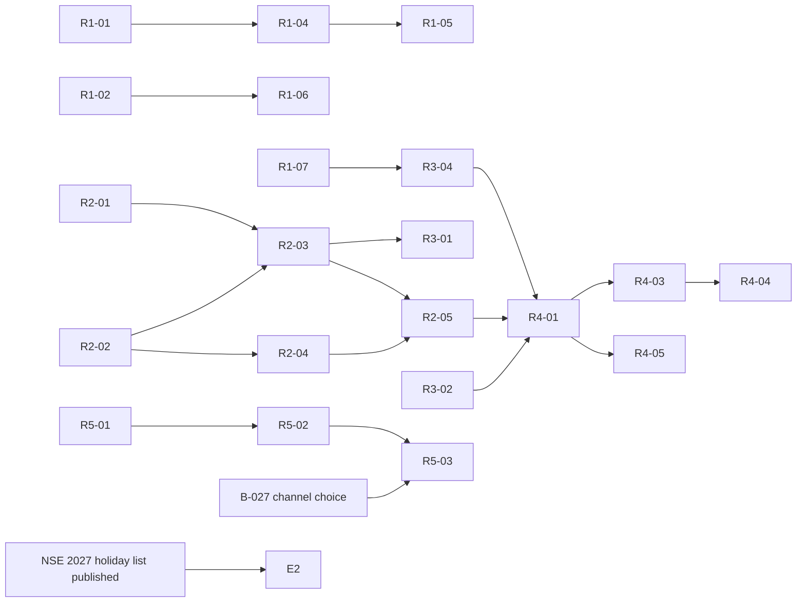

# 90-day execution roadmap and initial backlog (Deliverable 7)

- Owner: Product Owner (priority) and Delivery Coordinator (schedule). Reviewers: CTO, Head of Quant, Security Architect. Approver: founder.
- Window: **2026-11-30 to 2027-02-26**, six two-week sprints (R1 to R6). It starts only after the founder approves Phase 0.
- **Feature work is frozen until approval** (founder decision 2026-11-27, "full reset"). Unattended operations keep running: EOD, instrument master, backfill, the paper-trading job. Stopping them would lose data or paper history. Pending founder confirmation: see the decisions in [phase-0 README](../phase-0/README.md).

## 1. Epics (prioritised)

| Prio | Epic | Objective | Phase | Sprints |
|---|---|---|---|---|
| 1 | E1 Platform re-baseline | Supported versions, auth, audit, tenancy scaffold, outbox | 0 to 1 | R1 |
| 2 | E2 Calendar 2027 | Avoid the fail-closed stop on 2027-01-01 (R-10) | ops | R1 (as soon as NSE publishes) |
| 3 | E3 Source adapters and licensing | Announcement and news ingestion under verified terms | 1 | R2 |
| 4 | E4 Event processing | Normalise, resolve, classify, correlate, score | 1 | R2 to R3 |
| 5 | E5 MIA and briefing | Interpretation with validation and evidence | 1 | R3 to R4 |
| 6 | E6 Watchlists and alerts | Watchlists, alert rules, delivery channel (B-027) | 1 | R4 to R5 |
| 7 | E7 Intelligence UI | Feed, dossier events tab, briefing view, alerts inbox | 1 | R4 to R5 |
| 8 | E8 Hardening and Phase 1 exit | Security tests, evals, replay, docs | 1 | R6 |
| 9 | E9 Product discovery | Test H1 to H3; counsel and data quotes (no spend without approval) | 0 to 4 | R2 to R6, in parallel |

Phase 2 (quant: corporate actions B-020, delisted universe, walk-forward, fundamentals) starts after Day 90 (see section 5).

## 2. Sprint plan

| Sprint | Dates | Goal | Key stories |
|---|---|---|---|
| R0 | now, only if the founder exempts these from the freeze | Fix live defects | R0-01 localhost bind + Host/Origin guard + compose ports on 127.0.0.1 + Dockerfile JRE 25 + pinned Actions (draft PR, Platform & Security session); R0-02 corporate-action guard on held paper positions (R-20); R0-03 calendar 2027 load as soon as NSE publishes (R-10, deadline 2026-12-31); R0-04 terms review R2-01 (research, running in the Market Data & Licensing session) |
| R1 | 11-30 to 12-11 | Trustworthy decisions | R1-01 Boot 4.2.0 + Spring AI 2.1.0 pairing; R1-02 PG 18.7 (Testcontainers + compose); R1-03 Node 26 in CI; R1-04 BFF sign-in, single local user (ADR 0035); R1-05 audit_event + decider from principal (closes B-031, ADR 0037); R1-06 tenant keys migration (ADR 0036; no RLS); R1-07 ArchUnit rules 3 to 6 with a frozen baseline (ADR 0030); R1-08 CI gates actually built (Trivy, Semgrep, SBOM, Dependabot); R1-09 finish B-043 freshness API; R1-10 off-machine encrypted backup after the paper job + restore test; R1-11 ops alert channel by email (B-027; SMTP provider and its limits to verify); R1-12 `stopMode=NEXT_OPEN` reference rerun (R-21); R1-13 5 discovery interviews (founder) |
| R2 | 12-14 to 12-25 | Morning decision brief + inputs | R2-00 **morning decision brief** (facts only, existing code: freshness, open positions, stop distances, pending proposals, decision deadline 09:15) by 08:30 IST; R2-02 `data_source` registry + `source_document` + dedupe (ADR 0034); R2-03 first announcement adapter (only if R2-01 allows; otherwise the named fallback); R2-04 RSS headlines adapter; R2-05 FTS for documents |
| R3 | 12-28 to 01-08 | Events from documents | R3-00 outbox spike, Spring Modulith versus own (ADR 0032); R3-01 taxonomy + rules classifier; R3-02 prompt v3 name extraction + resolver (B-001, B-007); R3-03 price-reaction service (market model, z-score, ADR 0033); R3-04 two-phase significance; R3-05 eval sets 100/150/25/30 (draft datasets from the AI Evaluation session); R3-06 CSV research export; R3-07 BONUS_SPLIT/DIVIDEND events from announcements as the corporate-action source for B-020 |
| R4 | 01-11 to 01-22 | MIA end to end | R4-01 interpretation with fact slots + validator (ADR 0033); R4-02 quarantine view; R4-03 event API + contract; R4-04 intelligence feed UI **with thumbs feedback**; R4-05 MIA events added to the morning and post-EOD briefing |
| R5 | 01-25 to 02-05 | Personal workflow | R5-01 watchlists (default = open positions + pending proposals); R5-02 alert rules + in-app inbox; R5-03 alerts through the R1 channel; R5-04 dossier events tab. Scope is confirmed after the R1 interviews |
| R6 | 02-08 to 02-19 (+ buffer to 02-26) | Phase 1 exit | R6-01 30-day replay eval; R6-02 Semgrep/ZAP baseline clean; R6-03 Playwright e2e; R6-04 docs reflect the implementation; R6-05 Phase 1 exit review with the founder |

## 3. Selected user stories with acceptance criteria

**R1-04 Sign in with Keycloak** (Security, TOOL)
- Given the dev stack runs, when I open the cockpit, then I am redirected to Keycloak and return signed in, with tokens held only in memory.
- Given no token, when any `/api/v1` endpoint is called, then the response is 401 problem+json. `/actuator/health` stays public.
- Given the `prod` profile, when Keycloak issuer config is missing, then startup fails.

**R1-05 Decisions carry the authenticated decider** (closes B-031)
- Given I approve a paper order, then `decided_by` = my JWT `sub`, and an `audit_event` row records before/after with the correlation id.
- Given a request body containing `decidedBy`, then it is ignored (test).
- Given any UPDATE or DELETE on `audit_event`, then the DB rejects it (IT).

**R1-06 Tenant scaffold**
- Given two tenants in a test, when tenant A's context queries any tenant-scoped table, then zero rows of B are returned and inserts with B's id fail (TenantIsolationIT covers every tenant-scoped repository through reflection over `@TenantScoped` repositories).
- Given no tenant context, then a tenant-scoped query throws (fail closed).

**R2-03 Corporate announcement adapter**
- Given R2-01 records that automated access is permitted, when the job runs every 5 min during 08:00 to 20:00 IST, then new announcements are stored once (idempotent on external id), with URL, published_at and licence tag.
- Given a 403, captcha or bot challenge, then the job stops and alerts, and **does not retry around it**.
- If R2-01 does not permit access, the story is replaced by a licensed or broker source decision (founder).

**R3-02 Names extracted, tickers resolved in code**
- Given the 200-case resolution set, then linked-ISIN precision ≥ 0.98, and no output contains a symbol not produced by `SymbolResolverService`.

**R4-01 Validated interpretation**
- Given an interpretation containing a number not in the facts bundle, then the event is QUARANTINED with reason `NUMERIC_NOT_IN_FACTS`.
- Given citation `[E9]` without evidence E9, then QUARANTINED `CITATION_MISSING`.
- Given the injection set, then 0 adversarial documents produce a PUBLISHED event whose text follows the injected instruction.

**R4-05 Daily briefing**
- Given a trading day, when 08:15 IST arrives, then a briefing exists with "as of" = the last completed session (freshness API). Facts and AI interpretation are in separate sections. If the LLM budget is at a stop level, the briefing is the facts-only template.
- Given a holiday, then no pre-open briefing is generated (calendar).

## 4. Dependencies

## 5. After Day 90 (indicative)

- Phase 2 (quant, about 8 weeks): corporate actions source and adjustment (B-020), delisted universe, walk-forward, fundamentals source (licensing), risk review agent, paper go-live criteria report.
- Phase 3 (agentic): research Q&A with RAG, coordinator (LangGraph4j decision), MCP read-only tools.
- Phase 4 (SaaS): only after gates G1 to G3 are cleared.

## 6. Resource requirements

| Resource | Need | Cost |
|---|---|---|
| Founder time | **8 to 10 h/week**: paper decisions about 1 h, approvals and PR doubts, 5 interviews in R1, labelling the 30 interpretation eval cases, reviewing terms and counsel questions | time |
| Claude sessions | six standing sessions (charter) | existing subscription; no new spend |
| Laptop | 16 GB+ RAM for Postgres + Keycloak + Ollama 7 to 8B model | owned. A larger model (B-006) needs more RAM: founder decision |
| GitHub | repo + Actions | free tier (check private-repo minutes monthly) |
| Data | Upstox (existing token), public sources under verified terms | 0 |

## 7. Cost estimate

| Item | 90-day plan | Cost | When a decision is needed |
|---|---|---|---|
| All software in this plan | open source, self-hosted | **INR 0** | n/a |
| Ollama local models | local | 0 (electricity) | n/a |
| Alert channel (Telegram bot or email via an existing account) | R5 | expected 0, to verify per channel | R5 |
| Paid LLM API (B-010) | not planned | unknown until a provider and volume are chosen; estimate from R3 token measurements | after R3 if local quality fails gates |
| Licensed market data (S-07) / news API (S-12) | not planned | **unknown: quotes needed** | before Phase 4 |
| Securities and privacy counsel | not planned | **unknown: quotes needed** | before gates G1/G3 |
| Cloud (Phase 5) | not planned | estimate after the architecture is fixed; smallest viable: 1 VM + managed PG | Phase 5 |

**Planned spend in the 90 days: INR 0.** Every row marked unknown needs a quote and founder approval before any commitment.
