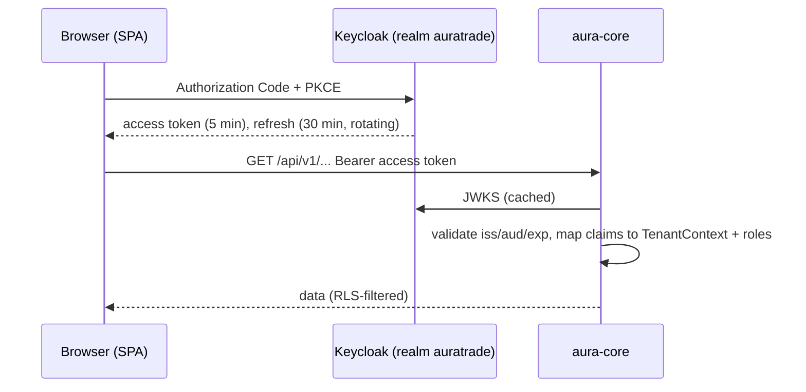

# Security architecture

- Owner: Security Architect (CISO role). Reviewers: Enterprise Architect, AI Security Engineer, Data Privacy. Approver: founder.
- Status: **DESIGN**. Today's state: there is **no authentication**. `/dev` and `/api/v1/paper` are served only in the `dev` profile, and paper decisions record `decided_by` as free text (B-031).

> **Review outcome:**
> - [ADR 0035](../adr/0035-authentication-bff.md) replaces section 2. Authentication is a BFF session (HttpOnly cookie, CSRF), with a single local user plus a passkey in R1 and Keycloak before gate G3. Step-up is bound to the decision, verified on the server, before any live order.
> - [ADR 0037](../adr/0037-audit-trail.md) replaces the audit design: a SECURITY DEFINER insert, a chain per tenant, a daily off-database anchor, and no personal data in payloads.
> - The SSRF control (T10) adds: no redirects, refuse private and loopback IP addresses after DNS resolution, and size and time caps.
> - The CI gates in section 4 are **planned, not built**. Today CI has Spotless, verify, gitleaks and dependency-review only, with Actions pinned by tag.
>
> **Live issues found (2026-11-27):**
> - **T0, LAN and cross-site exposure:** the app binds 0.0.0.0, `/dev` and `/api/v1/paper` POSTs are unauthenticated, and Postgres and Ollama ports are published on all interfaces.
> - The Dockerfile runs on JRE 21 with Java 25 bytecode.
>
> Both are proposed as freeze-exempt hotfixes (draft PR by the Platform & Security session).

## 1. Threat model summary (STRIDE, top items)

| # | Threat | Asset | Control | Phase |
|---|---|---|---|---|
| T1 | Spoofed decider approves a paper order | order decisions, later real money | OIDC sign-in; decider = JWT `sub`; step-up (passkey/WebAuthn) for approvals | R1 |
| T2 | Prompt injection in news/filings steers output | intelligence integrity | Structural controls in [ai-agent-architecture.md](../architecture/ai-agent-architecture.md) section 5; no side-effect tools; validation | R3 |
| T3 | Cross-tenant data read | tenant data | RLS + `aura_app` without BYPASSRLS + tenant isolation test suite | R1 (scaffold), Phase 4 |
| T4 | Provider token leak (Upstox, later LLM keys) | provider accounts | `.env` locally (git-ignored, exists); Secrets Manager in cloud; tokens never logged (log-masking test) | now |
| T5 | Tampered audit trail | non-repudiation | append-only trigger + hash chain + S3 Object Lock export (Phase 5) | R1/Phase 5 |
| T6 | Dependency/supply-chain compromise | build | pinned versions + digests, 14-day age rule, Trivy, SBOM, Actions pinned by SHA | R1 |
| T7 | `/dev` endpoints exposed outside dev | everything | `@Profile("dev")` (exists) + an ArchUnit test that dev controllers carry it + prod startup check failing if the dev profile is active together with prod | R1 |
| T8 | LLM cost exhaustion (denial of wallet) | budget | budget resolver + daily caps (exists); per-user rate limits | exists / Phase 4 |
| T9 | XSS through model or news text | user session | render as text only; CSP `default-src 'self'`; no `dangerouslySetInnerHTML` (ESLint rule) | R1 |
| T10 | SSRF through source URLs | internal network | source fetch only from the allow-listed host per `source` row; no model-chosen URLs | R2 |

## 2. Identity and access

- Tokens stay in memory in the SPA (oidc-client-ts), never in localStorage. Refresh rotation is on.
- Keycloak realm config is in git (`infrastructure/keycloak/realm-auratrade.json`, without secrets) and imported at container start in dev.
- Passkeys: Keycloak supports WebAuthn. Approving a paper order requires `acr=step-up` within the last 10 minutes (Phase 2, before any live order).
- **Roles (RBAC)**: `VIEWER` (read research), `TRADER` (decide own paper orders), `TENANT_ADMIN` (users, settings), `PLATFORM_ADMIN` (system, jobs, `/admin`; founder only).
- **Attributes (ABAC)**, checked in a `PolicyEvaluator` service called from `@PreAuthorize`: `resource.tenantId == principal.tenantId`; `paperAccount.ownerSub == principal.sub` for decisions; `subscription.plan` allows the feature (entitlements); `source.commercialUseAllowed || tenant.isFounder` for showing licence-restricted data (licensing control).
- Service-to-service: none yet (single deployable). When extracted: OAuth2 client credentials, then mTLS / SPIFFE if more than 3 services.

## 3. Data protection

- In transit: TLS 1.3 at the edge (CloudFront/ALB); TLS to RDS (`sslmode=verify-full`). Locally: HTTP on localhost only.
- At rest: RDS + S3 with KMS CMKs (Phase 5). Locally: BitLocker on the laptop is recommended (founder decision; not verifiable by us).
- Secrets: never in git (exists, plus a gitleaks pre-commit hook and CI job, R1). The prod profile has no defaults.
- PII inventory (DPDP): email, name and Keycloak id per user, and IP in access logs. No financial account data, no PAN/Aadhaar. The broker link (Phase 2+) would add broker client id: a re-assessment trigger.

## 4. Secure SDLC gates (CI)

| Gate | Tool | Blocks merge |
|---|---|---|
| Format/lint | Spotless, ESLint | yes |
| Unit + integration | JUnit, Testcontainers, Vitest | yes |
| Architecture rules | ArchUnit (incl. new rules T7, agents read-only) | yes |
| Secrets | gitleaks | yes |
| SAST | Semgrep CE (java, typescript, owasp-top-ten rulesets) | high/critical |
| Dependencies/images | Trivy fs + image, `npm audit --omit=dev` | critical/high with fix |
| SBOM | CycloneDX (Maven + npm) attached to the build | n/a |
| DAST | OWASP ZAP baseline against the dev profile in CI | Phase 5 |
| AI | injection golden set `-Peval` | nightly, regressions block release |

## 5. Audit

Recorded actions: sign-in/out (from Keycloak events), paper order decide/edit/cancel, account create/close, settings change, alert rule change, model registry change, source enable/disable, job manual run, event retraction, data export. Each record holds actor `sub`, kind, before/after, correlation id and a hash chain. The audit has no delete path in the application, and the DB trigger rejects UPDATE/DELETE.
